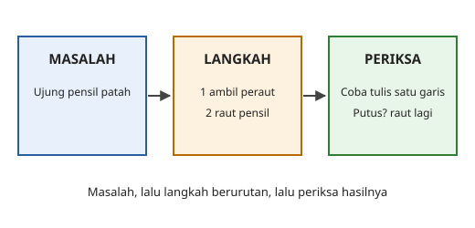

**Ingat dulu:** Tanpa melihat catatan, tulis satu hal tentang algoritma seperti resep.

**Contoh:** Ujung pensil Kancil patah.

`[Gambar: tiga kotak berpanah. Kotak biru "masalah: ujung pensil patah". Kotak oranye "langkah: ambil peraut, raut pensil". Kotak hijau "periksa: tulis satu garis".]`

| Masalah | Langkah | Periksa |
| --- | --- | --- |
| Ujung pensil patah | 1 ambil peraut, 2 raut pensil | Tulis satu garis. Putus? Raut lagi. |

**Bandingkan:** Sepatu Kura-kura basah. Langkah: lepas sepatu, lap dengan kain, taruh di tempat berangin. Periksa: raba bagian dalam.

Apa yang sama pada pensil dan sepatu? ______

Apa yang beda? ______

**Coba:** Penghapus Pak Gagak hilang.

| Masalah | Langkah | Periksa |
| --- | --- | --- |
| Penghapus hilang | 1 ______ 2 ______ | ______ |

Sekarang sendiri: pilih satu masalah kecil di kelas atau di rumah. Jangan tulis alamat atau nomor telepon.

| Masalah | Langkah | Periksa |
| --- | --- | --- |
| | | |

**Ceritakan** ke temanmu: apa tiga bagian cara memecahkan masalah?

**Catatan cetak (untuk guru, tidak dicetak):** satu lembar per murid, kertas A4. Lembar tidak memuat kolom nama, kelompok, tanggal, atau nilai; penandaan kertas diurus guru di sekolah.
