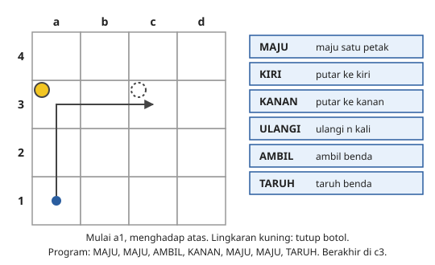

**Ingat dulu:** Tanpa melihat catatan, tulis mengapa mesin perlu berhenti ketika syaratnya sudah terpenuhi.

**Contoh:** Mesin mulai di a1 menghadap atas. Tutup botol di a3.

`[Gambar: kisi 4x4, kolom a sampai d, baris 1 sampai 4. Panah dari a1 naik ke a3, lalu ke kanan sampai c3. Tutup botol di a3 dan lingkaran putus-putus di c3. Di kanan enam kata: MAJU, KIRI, KANAN, ULANGI, AMBIL, TARUH.]`

Program: MAJU, MAJU, AMBIL, KANAN, MAJU, MAJU, TARUH. Berakhir di c3.

**Bandingkan:**

| Program | Berhenti di |
| --- | --- |
| A: MAJU, MAJU, AMBIL, BELOK KANAN, MAJU, MAJU, TARUH | ______ |
| B: MAJU, MAJU, AMBIL, KANAN, MAJU, MAJU, TARUH | c3 |

Apa yang sama? Apa yang beda? ______

**Coba:** Tutup botol di c1. Pindahkan ke c3.

KANAN, ULANGI 2 kali MAJU, AMBIL, ____, ULANGI 2 kali MAJU, ____

Sekarang sendiri: mesin tetap mulai di a1 menghadap atas. Tutup botol di d2. Pindahkan ke a2. Tulis programmu dengan enam kata.

______

Teman menjalankannya. Benar? ______

**Ceritakan** ke temanmu mengapa mesin hanya boleh memakai enam kata.

**Catatan cetak (untuk guru, tidak dicetak):** satu lembar per murid, kertas A4. Lembar tidak memuat kolom nama, kelompok, tanggal, atau nilai; penandaan kertas diurus guru di sekolah.
