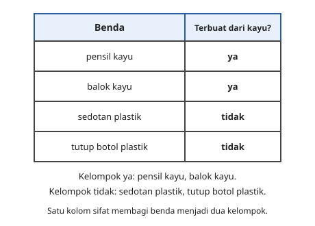

**Ingat dulu:** Tanpa melihat catatan, tulis apa isi baris dan apa isi kolom pada tabel.

**Contoh:** Tabel sifat dengan satu sifat.

`[Gambar: tabel dengan kolom benda dan "terbuat dari kayu?". Pensil kayu ya, balok kayu ya, sedotan plastik tidak, tutup botol plastik tidak. Di bawahnya dua kelompok: ya dan tidak.]`

**Bandingkan:** Benda yang sama, dua sifat.

| Benda | Terbuat dari kayu? | Berbentuk panjang? |
| --- | --- | --- |
| pensil kayu | ya | ya |
| balok kayu | ya | tidak |
| sedotan plastik | tidak | ya |
| tutup botol plastik | tidak | tidak |

Berapa kelompok dengan satu sifat? ____ Dengan dua sifat? ____

Apa yang sama? Apa yang beda? ______

**Coba:** Tambah dua benda.

| Benda | Terbuat dari kayu? | Berbentuk panjang? |
| --- | --- | --- |
| sendok kayu | | |
| piring plastik | | |

Siapa sekelompok dengan pensil kayu? ______

Sekarang sendiri:

| Benda | Berwarna merah? | Bentuknya bulat? |
| --- | --- | --- |
| apel merah | | |
| pisang kuning | | |
| bola biru | | |
| cabai merah | | |

Dua benda yang berwarna merah: ______

**Ceritakan** ke temanmu bagaimana tabel membantu mengelompokkan.

**Catatan cetak (untuk guru, tidak dicetak):** satu lembar per murid, kertas A4. Lembar tidak memuat kolom nama, kelompok, tanggal, atau nilai; penandaan kertas diurus guru di sekolah.
