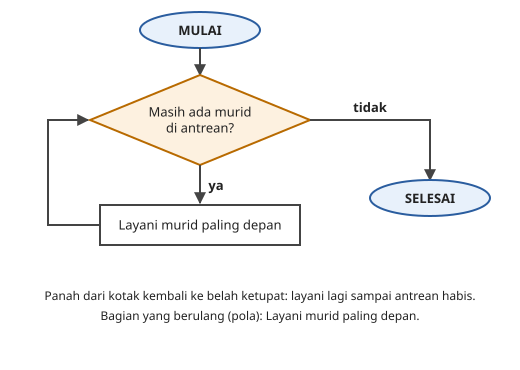

**Ingat dulu:** Tanpa melihat catatan, tulis bila satu langkah dalam panduan salah, bagaimana kamu menemukan dan memperbaikinya.

**Contoh:** Masalah antrean kantin.

`[Gambar: diagram alir. MULAI, belah ketupat "masih ada murid di antrean?". Ya ke kotak "layani murid paling depan" dengan panah kembali ke belah ketupat. Tidak ke SELESAI.]`

Periksa: tiga kartu murid, pion lewat kotak layani tiga kali.

**Bandingkan:** A: antre, pesan, bayar. B: diagram di atas.

Apa yang sama? Apa yang beda? Mana yang bisa melayani tiga murid? ______

**Coba:** Pojok baca berantakan.

MULAI → "masih ada buku di lantai?" → ya → [ ______ ] → kembali ke pertanyaan. Tidak → SELESAI.

Cara memeriksa: ______

Sekarang sendiri: papan tulis kotor setelah pelajaran.

| Bagian | Jawabanku |
| --- | --- |
| Masalah | |
| Dua bagian kecil | |
| Informasi penting | |
| Informasi yang dibuang | |
| Diagram (gambar di kotak bawah) | |
| Cara memeriksa | |

[Kotak kosong untuk menggambar]

**Ceritakan** ke temanmu bagian mana yang berulang pada panduanmu.

**Catatan cetak (untuk guru, tidak dicetak):** satu lembar per murid, kertas A4. Lembar tidak memuat kolom nama, kelompok, tanggal, atau nilai; penandaan kertas diurus guru di sekolah.
