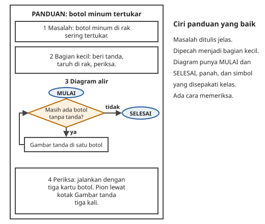

**Ingat dulu:** Tanpa melihat catatan, tulis mengapa langkah dalam diagram alir diberi panah.

**Contoh:** Panduan satu halaman "Botol minum tertukar".

`[Gambar: kertas dengan empat bagian: masalah, bagian kecil, diagram alir kecil (MULAI, belah ketupat "masih ada botol tanpa tanda?", ya ke kotak gambar tanda dan kembali, tidak ke SELESAI), dan periksa. Di kanan daftar ciri panduan yang baik.]`

**Bandingkan:** A: "Rapikan botol. Jangan lupa tandai. Beres." B: halaman di atas.

Apa yang sama? Apa yang beda? Panduan mana yang bisa dijalankan teman tanpa bertanya? ______

**Coba:** Masalah: rak sepatu berantakan.

| Bagian | Isi |
| --- | --- |
| 1 Masalah | Sepatu di rak berantakan. |
| 2 Bagian kecil | kumpulkan sepatu, ______, periksa |
| 3 Diagram | MULAI, "masih ada sepatu di lantai?", ya ____, tidak SELESAI |
| 4 Periksa | ______ |

Sekarang kelompok: pilih satu masalah dari daftar guru. Tulis empat bagian di satu halaman dan gambar diagram di kotak.

[Kotak kosong untuk menggambar]

Penguji menjalankan dengan tiga kartu. Pion macet? ______

**Ceritakan** ke kelompok lain satu bagian panduanmu.

**Catatan cetak (untuk guru, tidak dicetak):** satu lembar per murid atau per kelompok, kertas A4. Lembar tidak memuat kolom nama, kelompok, tanggal, atau nilai; penandaan kertas diurus guru di sekolah.
