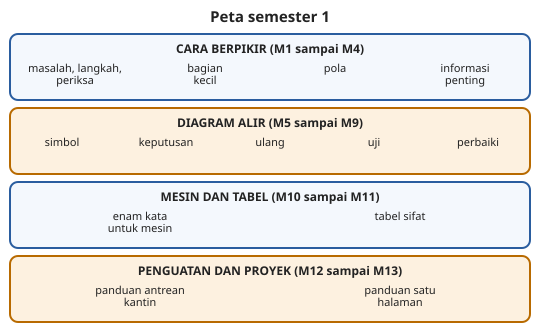

**Ingat dulu:** Tanpa melihat catatan, tulis satu hal dari semester ini yang paling kamu ingat.

**Contoh:** Latihan bentuk soal dengan jawaban lengkap: memilih buah.

`[Gambar: empat baris. Cara berpikir minggu satu sampai empat. Diagram alir minggu lima sampai sembilan. Mesin dan tabel minggu sepuluh dan sebelas. Penguatan dan proyek minggu dua belas dan tiga belas.]`

Soal: apel, pisang, jeruk. Mana yang kulitnya kuning? Jawaban: pisang, karena kulitnya kuning.

**Bandingkan:**

- Jawaban A: "pisang."
- Jawaban B: "pisang, karena kulitnya kuning."

Apa yang sama? Apa yang beda? Mana yang memuat alasan? ______

**Coba:** Diagram: MULAI, "pintu kelas tertutup?". Ya: ketuk pintu. Tidak: masuk kelas. SELESAI.

Pintu tertutup. Jalan: ______ Hasil: ______

Sekarang sendiri: tulis satu masalah sehari-hari, satu langkah, dan satu cara memeriksa.

| Masalah | Langkah | Periksa |
| --- | --- | --- |
| | | |

**Refleksi:** Tulis satu hal yang paling berguna dan satu hal yang mau dipelajari lagi.

______

**Ceritakan** ke temanmu satu hal yang kamu pelajari semester ini.

**Catatan cetak (untuk guru, tidak dicetak):** satu lembar per murid, kertas A4. Lembar ini latihan bentuk soal, bukan soal asesmen; guru menyusun soal asesmen sendiri. Lembar tidak memuat kolom nama, kelompok, tanggal, atau nilai; penandaan kertas diurus guru di sekolah.
