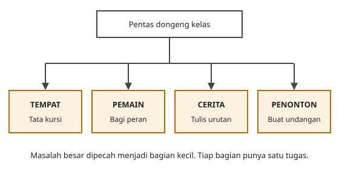

**Ingat dulu:** Tanpa melihat catatan, tulis tiga bagian cara memecahkan masalah.

**Contoh:** Kelas Kancil menyiapkan pentas dongeng.

`[Gambar: kotak besar "pentas dongeng kelas" dengan empat panah turun ke kotak tempat (tata kursi), pemain (bagi peran), cerita (tulis urutan), dan penonton (buat undangan).]`

**Bandingkan:**

| | A | B |
| --- | --- | --- |
| Isi | satu kotak: "siapkan pentas" | empat bagian |
| Tahu mulai dari mana? | | |

Apa yang sama? Apa yang beda? ______

**Coba:** Kelas membersihkan pojok baca.

| Bagian | Tugas |
| --- | --- |
| Buku | susun di rak |
| Lantai | sapu |
| ______ | ______ |

Sekarang sendiri: kelompokmu menyiapkan lomba menggambar di kelas. Tulis tiga atau empat bagian.

| Bagian | Tugas |
| --- | --- |
| | |
| | |
| | |

**Ceritakan** ke temanmu: mengapa masalah besar lebih mudah bila dipecah?

**Catatan cetak (untuk guru, tidak dicetak):** satu lembar per murid, kertas A4. Lembar tidak memuat kolom nama, kelompok, tanggal, atau nilai; penandaan kertas diurus guru di sekolah.
