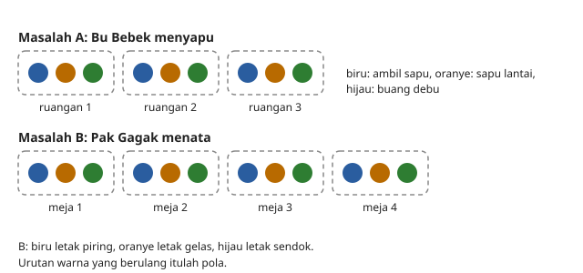

**Ingat dulu:** Tanpa melihat catatan, gambar satu pola berulang dari manik atau kartu.

**Contoh:** Masalah A: Bu Bebek menyapu tiga ruangan. Tiap ruangan: ambil sapu, sapu lantai, buang debu.

`[Gambar: dua baris kelompok lingkaran. Baris A: tiga ruangan, tiap ruangan biru, oranye, hijau. Baris B: empat meja, tiap meja biru, oranye, hijau.]`

**Bandingkan:** Masalah B: Pak Gagak menata empat meja. Tiap meja: letak piring, letak gelas, letak sendok.

| | A | B |
| --- | --- | --- |
| Langkah yang berulang | ambil sapu, sapu lantai, buang debu | |
| Berapa kali? | 3 | |

Apa yang sama? Apa yang beda? ______

**Coba:** Kancil membagikan buku ke empat meja. Tiap meja: ambil buku, ______, geser ke meja berikutnya.

Pola diulang ______ kali.

Sekarang sendiri: pilih satu kegiatan harian yang berulang. Tulis dua putaran, lalu lingkari pola.

| Putaran 1 | Putaran 2 |
| --- | --- |
| | |

**Ceritakan** ke temanmu: apa yang disebut pola?

**Catatan cetak (untuk guru, tidak dicetak):** satu lembar per murid, kertas A4. Lembar tidak memuat kolom nama, kelompok, tanggal, atau nilai; penandaan kertas diurus guru di sekolah.
