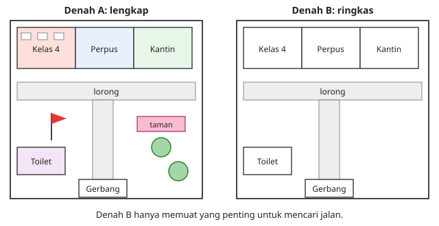

**Ingat dulu:** Tanpa melihat catatan, tulis satu bagian yang berulang pada dua masalah.

**Contoh:** Kura-kura murid baru. Ia ingin ke perpustakaan dari gerbang.

`[Gambar: dua denah sekolah fiktif berdampingan. Denah A lengkap dengan taman, pohon, dan tiang bendera. Denah B hanya gerbang, lorong, kelas 4, perpustakaan, kantin, dan toilet.]`

Penting: gerbang, lorong, perpustakaan. Tidak penting: warna atap, pohon.

**Bandingkan:**

| | Denah A | Denah B |
| --- | --- | --- |
| Ada hiasan? | | |
| Mudah dipakai? | | |

Apa yang sama? Apa yang beda? ______

**Coba:** Bu Bebek ingin ke toilet dari kantin. Lingkari yang penting.

letak kantin · warna atap · letak toilet · pohon · lorong · taman

Sekarang sendiri: dari kelas 4 ke gerbang.

| Tiga hal yang penting | Dua hal yang dibuang |
| --- | --- |
| | |

**Ceritakan** ke temanmu: mengapa tidak semua informasi perlu dibawa?

**Catatan cetak (untuk guru, tidak dicetak):** satu lembar per murid, kertas A4. Lembar tidak memuat kolom nama, kelompok, tanggal, atau nilai; penandaan kertas diurus guru di sekolah.
