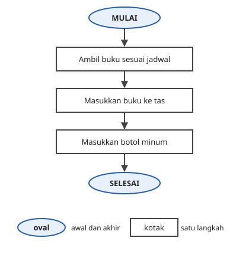

**Ingat dulu:** Tanpa melihat catatan, tulis mengapa kita memilih informasi yang penting.

**Contoh:** Menyiapkan tas sekolah.

`[Gambar: diagram alir dari atas ke bawah. Oval MULAI, kotak ambil buku sesuai jadwal, kotak masukkan buku ke tas, kotak masukkan botol minum, oval SELESAI, dengan panah di antaranya.]`

Oval: awal dan akhir. Kotak: satu langkah. Panah: arah.

**Bandingkan:** A: daftar langkah. B: diagram alir.

| | A: daftar | B: diagram alir |
| --- | --- | --- |
| Ada panah? | | |
| Ada MULAI dan SELESAI? | | |

Apa yang sama? Apa yang beda? ______

**Coba:** Mencuci tangan. Isi dua kotak kosong.

MULAI → basahi tangan → [ ______ ] → bilas dengan air → [ ______ ] → SELESAI

Sekarang sendiri: gambar diagram alir untuk satu kegiatan pagi, paling banyak empat langkah. Pakai oval, kotak, dan panah.

[Kotak kosong untuk menggambar]

**Ceritakan** ke temanmu: apa arti oval, kotak, dan panah?

**Catatan cetak (untuk guru, tidak dicetak):** satu lembar per murid, kertas A4. Lembar tidak memuat kolom nama, kelompok, tanggal, atau nilai; penandaan kertas diurus guru di sekolah.
