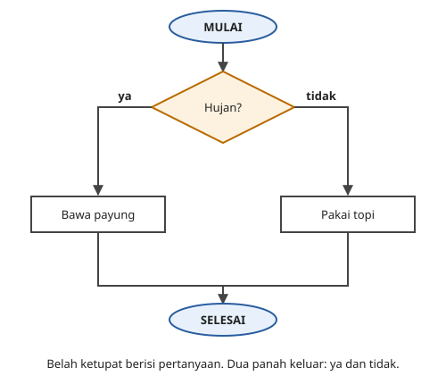

**Ingat dulu:** Tanpa melihat catatan, gambar tiga simbol diagram alir dan tulis artinya.

**Contoh:** Berangkat ke sekolah.

`[Gambar: diagram alir. Oval MULAI, belah ketupat "hujan?", panah ya ke kotak bawa payung, panah tidak ke kotak pakai topi, keduanya ke oval SELESAI.]`

Belah ketupat berisi pertanyaan. Jawabannya ya atau tidak.

**Bandingkan:** B: "Bel sudah bunyi?" Ya: masuk kelas. Tidak: bermain di halaman.

| | A: hujan? | B: bel? |
| --- | --- | --- |
| Jalan "ya" | bawa payung | |
| Jalan "tidak" | pakai topi | |

Apa yang sama? Apa yang beda? ______

**Coba:** Pintu kelas tertutup?

Ya → [ ______ ]. Tidak → masuk kelas.

Sekarang sendiri: gambar diagram alir untuk robot. Jika ada tembok di depan, robot KIRI. Jika tidak, robot MAJU.

[Kotak kosong untuk menggambar]

**Ceritakan** ke temanmu: apa fungsi belah ketupat?

**Catatan cetak (untuk guru, tidak dicetak):** satu lembar per murid, kertas A4. Lembar tidak memuat kolom nama, kelompok, tanggal, atau nilai; penandaan kertas diurus guru di sekolah.
