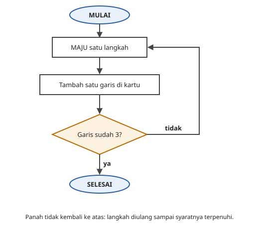

**Ingat dulu:** Tanpa melihat catatan, tulis apa isi belah ketupat dan apa dua panahnya.

**Contoh:** Robot MAJU tiga langkah.

`[Gambar: diagram alir. MULAI, kotak MAJU satu langkah, kotak tambah satu garis di kartu, belah ketupat "garis sudah 3?". Ya ke SELESAI. Tidak, panah kembali ke kotak MAJU.]`

Panah yang kembali ke atas membuat langkah diulang.

**Bandingkan:** A: MULAI, MAJU, MAJU, MAJU, SELESAI. B: diagram dengan panah kembali.

| | A | B |
| --- | --- | --- |
| Kotak MAJU yang digambar | 3 | |
| Langkah robot | 3 | |
| Untuk 5 langkah | | |

Apa yang sama? Apa yang beda? ______

**Coba:** Ketuk meja sampai 4 kali. Isi dan lengkapi panah.

MULAI → ketuk meja → tambah satu garis → belah ketupat "garis sudah ____?" → ya → SELESAI

Gambar panah "tidak" kembali ke ______.

Sekarang sendiri: gambar diagram untuk robot yang MAJU 5 langkah.

[Kotak kosong untuk menggambar]

**Ceritakan** ke temanmu: kapan robot berhenti mengulang?

**Catatan cetak (untuk guru, tidak dicetak):** satu lembar per murid, kertas A4. Lembar tidak memuat kolom nama, kelompok, tanggal, atau nilai; penandaan kertas diurus guru di sekolah.
