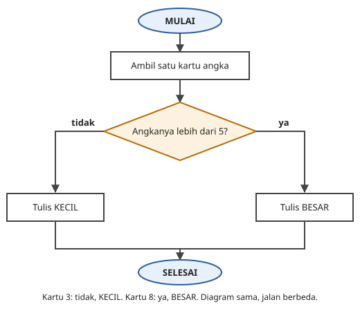

**Ingat dulu:** Tanpa melihat catatan, tulis jalan mana yang diambil bila jawaban belah ketupat ya, dan jalan mana bila tidak.

**Contoh:** Jalankan diagram dengan kartu 3.

`[Gambar: diagram alir. MULAI, kotak ambil satu kartu angka, belah ketupat "angkanya lebih dari 5?". Ya ke kotak tulis BESAR, tidak ke kotak tulis KECIL, keduanya ke SELESAI.]`

Kartu 3. Lebih dari 5? Tidak. Hasil: KECIL.

**Bandingkan:** Diagram yang sama, dua kartu.

| Kartu | Lebih dari 5? | Hasil |
| --- | --- | --- |
| 3 | tidak | KECIL |
| 8 | | |

Apa yang sama? Apa yang beda? ______

**Coba:** Kartu 5.

| Kartu | Lebih dari 5? | Hasil |
| --- | --- | --- |
| 5 | ______ | ______ |

Sekarang sendiri: MULAI, ambil kartu, "lebih dari 10?". Ya: ambil dua kue. Tidak: ambil satu kue. SELESAI.

| Kartu | Lebih dari 10? | Hasil |
| --- | --- | --- |
| 12 | | |
| 10 | | |
| 4 | | |

Satu angka lain yang perlu diuji: ____ Mengapa? ______

**Ceritakan** ke temanmu mengapa satu diagram diuji dengan banyak kartu.

**Catatan cetak (untuk guru, tidak dicetak):** satu lembar per murid, kertas A4. Lembar tidak memuat kolom nama, kelompok, tanggal, atau nilai; penandaan kertas diurus guru di sekolah.
