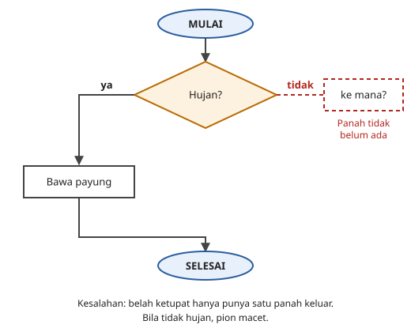

**Ingat dulu:** Tanpa melihat catatan, tulis apa yang kamu periksa pada belah ketupat.

**Contoh:** Diagram "Hujan?" ini salah. Jalankan dengan masukan "tidak hujan".

`[Gambar: diagram alir. MULAI, belah ketupat "hujan?", panah ya ke kotak bawa payung lalu SELESAI. Panah tidak hanya garis putus-putus ke kotak "ke mana?".]`

Pion macet di belah ketupat. Perbaikan: tambah panah tidak ke "pakai topi".

**Bandingkan:** A: MULAI, ketuk, "garis sudah 3?", ya SELESAI, tidak kembali ke ketuk. B: sama, ditambah kotak "tambah satu garis".

| | A | B |
| --- | --- | --- |
| Garis bertambah? | tidak | |
| Berhenti? | tidak pernah | |

Apa yang sama? Apa yang beda? ______

**Coba:** MULAI, pakai sepatu, ikat tali, pakai kaus kaki, SELESAI. Urutan benar: ______, ______, ______

Sekarang sendiri: MULAI, tepuk, tambah satu garis, "garis sudah 4?". Ya kembali ke tepuk. Tidak ke SELESAI.

Berapa kali tepuk? ____ Apa yang salah? ______

Tulis cara memperbaikinya, lalu jalankan lagi: ______

**Ceritakan** ke temanmu empat langkah memperbaiki diagram.

**Catatan cetak (untuk guru, tidak dicetak):** satu lembar per murid, kertas A4. Lembar tidak memuat kolom nama, kelompok, tanggal, atau nilai; penandaan kertas diurus guru di sekolah.
