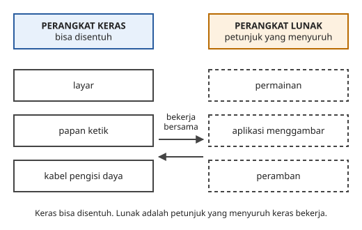

**Ingat dulu:** Tanpa melihat catatan, tulis satu perangkat di sekitarmu dan apa gunanya.

**Contoh:** Mesin dan lembar program.

`[Gambar: dua kolom. Kolom perangkat keras, bisa disentuh, berisi layar, papan ketik, kabel pengisi daya. Kolom perangkat lunak, petunjuk yang menyuruh, berisi permainan, aplikasi menggambar, peramban. Panah di tengah bertuliskan bekerja bersama.]`

Mesin bisa disentuh: perangkat keras. Lembar program menyuruh mesin: perangkat lunak.

**Bandingkan:** A: papan ketik. B: aplikasi menggambar.

| | A | B |
| --- | --- | --- |
| Bisa disentuh? | ya | |
| Berupa petunjuk? | | |

Apa yang sama? Apa yang beda? ______

**Coba:** Tulis K (keras) atau L (lunak).

| Kartu | K atau L |
| --- | --- |
| layar | K |
| permainan | ______ |
| pengeras suara | ______ |

Sekarang sendiri: tulis K atau L.

| Kartu | K atau L |
| --- | --- |
| tetikus | |
| pemutar musik | |
| printer | |
| aplikasi jam | |

Tulis satu pasangan yang bekerja bersama: perangkat keras ______ dan perangkat lunak ______

**Ceritakan** ke temanmu: apa beda perangkat keras dan perangkat lunak?

**Catatan cetak (untuk guru, tidak dicetak):** satu lembar per murid, kertas A4. Lembar tidak memuat kolom nama, kelompok, tanggal, atau nilai; penandaan kertas diurus guru di sekolah.
