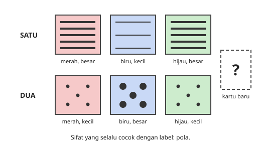

**Ingat dulu:** Tanpa melihat catatan, tulis apa yang dibaca mesin dari gambar piksel.

**Contoh:** Enam kartu contoh. Mesin kartu melihatnya dulu.

`[Gambar: dua baris kartu. Baris SATU: tiga kartu bergaris, merah besar, biru kecil, hijau besar. Baris DUA: tiga kartu bintik, merah kecil, biru besar, hijau kecil. Di kanan satu kartu bertanda tanya.]`

| Label | Pola | Warna | Ukuran |
| --- | --- | --- | --- |
| SATU | garis | merah | besar |
| SATU | garis | biru | kecil |
| SATU | garis | hijau | besar |
| DUA | bintik | merah | kecil |
| DUA | bintik | biru | besar |
| DUA | bintik | hijau | kecil |

**Bandingkan:** Tebakan lewat warna dan tebakan lewat pola.

Apa yang sama? Apa yang beda? Sifat mana yang selalu cocok dengan label? ______

**Coba:** Kartu baru bergaris kuning kecil.

Tebakanku: ______ Karena: ______

Kartu polos hijau besar. Yakin atau ragu? ______ Mengapa? ______

Sekarang sendiri: kartu bintik kuning besar.

Tebakanku: ______ Yakin atau ragu? ______

**Ceritakan** ke temanmu: mengapa mesin kartu perlu contoh?

**Catatan cetak (untuk guru, tidak dicetak):** satu lembar per murid, kertas A4. Lembar tidak memuat kolom nama, kelompok, tanggal, atau nilai; penandaan kertas diurus guru di sekolah.
