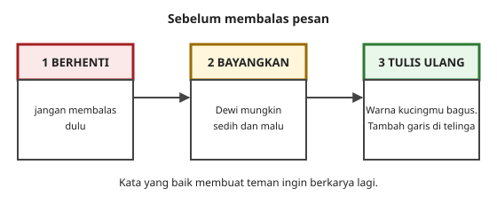

**Ingat dulu:** Tanpa melihat catatan, tulis satu pertanyaan cek untuk sebuah pesan.

**Contoh:** Dewi menggambar kucing. Rangga membalas: "Gambarmu jelek, jangan ikut lomba!"

`[Gambar: tiga kotak berpanah. Kotak satu: berhenti, jangan membalas dulu. Kotak dua: bayangkan, Dewi mungkin sedih. Kotak tiga: tulis ulang, warna kucingmu bagus.]`

**Bandingkan:**

- Pesan A: "Gambarmu jelek, jangan ikut lomba!"
- Pesan B: "Warna kucingmu bagus. Mungkin tambah garis di telinganya."

Apa yang sama? Apa yang beda? Mana yang membuat Dewi ingin menggambar lagi? ______

**Coba:** "Kamu lambat, tim kalah gara-gara kamu!"

| Langkah | Jawabanku |
| --- | --- |
| Berhenti | jangan membalas dulu |
| Bayangkan: perasaan penerima | ______ |
| Tulis ulang | ______ |

Sekarang sendiri: "Kamu tidak boleh main sama kami!"

Tulis ulang: ______

Bila menerima pesan seperti itu, aku memberi tahu: ______

**Ceritakan** ke temanmu: mengapa kita membayangkan perasaan penerima sebelum mengirim?

**Catatan cetak (untuk guru, tidak dicetak):** satu lembar per murid, kertas A4. Semua tokoh fiktif; murid tidak menulis kejadian nyata. Lembar tidak memuat kolom nama, kelompok, tanggal, atau nilai; penandaan kertas diurus guru di sekolah.
