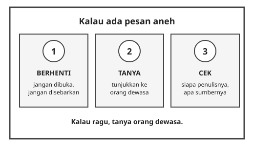

**Ingat dulu:** Tanpa melihat catatan, tulis satu informasi RAHASIA dan satu alasannya.

**Contoh:** Panduan "Kalau ada pesan aneh".

`[Gambar: panduan satu halaman. Judul: kalau ada pesan aneh. Tiga kotak bernomor: satu, berhenti, jangan dibuka dan jangan disebarkan. Dua, tanya, tunjukkan ke orang dewasa. Tiga, cek, siapa penulisnya dan apa sumbernya. Di bawah: kalau ragu, tanya orang dewasa.]`

**Bandingkan:**

- Panduan A: "Hati-hati di internet!"
- Panduan B: panduan tiga aturan di atas.

Panduan mana yang bisa dijalankan adik kelas tanpa bertanya lagi? Mengapa? ______

**Coba:** Pilih topik: kata sandi. Isi tindakan.

| Aturan | Tindakan |
| --- | --- |
| 1. Kata sandi | jangan beri tahu teman, hanya orang tua |
| 2. Informasi rahasia | ______ |
| 3. Cek pesan | ______ |

Sekarang sendiri, di kertas panduan:

1. Gambar satu gambar untuk tiap aturan.
2. Tulis satu kalimat: "Kalau ragu, ______."
3. Uji pada teman yang berperan sebagai adik kelas. Ia menyebut tiga aturan tanpa melihat.

Satu perbaikan dari ujiku: ______

Jangan tulis kata sandi atau alamat sungguhan.

**Ceritakan** ke temanmu: mengapa panduan perlu diuji?

**Catatan cetak (untuk guru, tidak dicetak):** satu lembar per murid, kertas A4; panduan satu halaman per kelompok memakai kertas terpisah. Lembar tidak memuat kolom nama, kelompok, tanggal, atau nilai; penandaan kertas diurus guru di sekolah.
