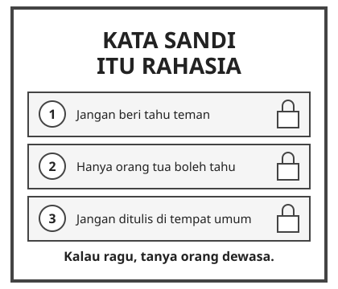

**Ingat dulu:** Tanpa melihat catatan, tulis dua ciri poster yang mudah dibaca teman.

**Contoh:** Poster "Kata sandi itu rahasia".

`[Gambar: poster. Judul besar: kata sandi itu rahasia. Tiga kotak bernomor dengan satu gambar sederhana tiap kotak. Di bawah: kalau ragu, tanya orang dewasa.]`

**Bandingkan:** Halaman A: semua isi dalam paragraf padat berhuruf kecil. Halaman B: poster contoh.

| | Halaman A | Halaman B |
| --- | --- | --- |
| Besar huruf | kecil | |
| Gambar | tidak ada | |
| Bisa dibaca dari 2 meter? | tidak | |

Apa yang sama? Apa yang beda? ______

**Coba:** Periksa poster contoh.

| Ciri | Ada? |
| --- | --- |
| judul besar | ya |
| tiga aturan bernomor | ______ |
| satu gambar tiap aturan | ______ |
| kalimat "Kalau ragu" | ______ |

Sekarang sendiri, di kertas poster: buat posternya dengan kelompokmu. Pemeriksa membaca dari 2 meter.

Satu perbaikan setelah dibaca pemeriksa: ______

Jangan tulis data pribadi atau kata sandi sungguhan.

**Ceritakan** ke temanmu: mengapa huruf besar dan gambar membantu pembaca?

**Catatan cetak (untuk guru, tidak dicetak):** satu lembar per murid, kertas A4; poster per kelompok memakai kertas terpisah. Lembar tidak memuat kolom nama, kelompok, tanggal, atau nilai; penandaan kertas diurus guru di sekolah.
