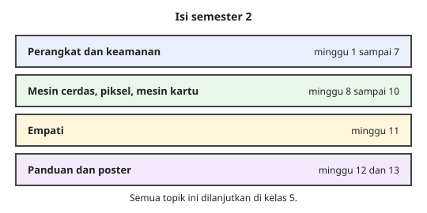

**Ingat dulu:** Tanpa melihat catatan, tulis satu hal dari semester ini yang paling kamu ingat.

**Contoh:** Latihan bentuk soal dengan jawaban lengkap: memilih hewan.

`[Gambar: empat baris. Perangkat dan keamanan minggu satu sampai tujuh. Mesin cerdas, piksel, dan mesin kartu minggu delapan sampai sepuluh. Empati minggu sebelas. Panduan dan poster minggu dua belas dan tiga belas.]`

Soal: ikan, burung, kucing. Mana yang bisa terbang? Jawaban: burung, karena punya sayap.

**Bandingkan:**

- Jawaban A: "burung."
- Jawaban B: "burung, karena punya sayap."

Apa yang sama? Apa yang beda? Mana yang memuat alasan? ______

**Coba:** Baca angka: 11111, 00100, 00100, 00100, 00100.

Gambar apa? ______ Kotak gelap: ____

Sekarang sendiri: tulis ulang pesan ini dengan kata baik.

| Pesan | Tulis ulang |
| --- | --- |
| "Kamu lambat!" | ______ |

**Refleksi:** Tulis tiga hal yang sudah bisa kamu lakukan dan satu hal yang mau dilatih di kelas 5.

______

**Ceritakan** ke temanmu satu hal yang kamu pelajari semester ini.

**Catatan cetak (untuk guru, tidak dicetak):** satu lembar per murid, kertas A4. Lembar ini latihan bentuk soal, bukan soal asesmen; guru menyusun soal asesmen sendiri. Lembar tidak memuat kolom nama, kelompok, tanggal, atau nilai; penandaan kertas diurus guru di sekolah.
