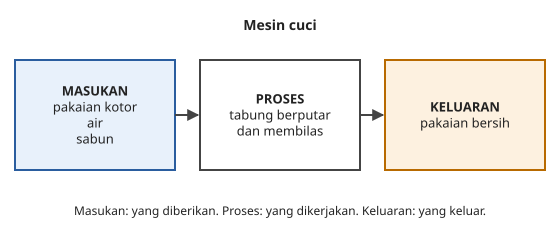

**Ingat dulu:** Tanpa melihat catatan, tulis satu perangkat keras dan satu perangkat lunak.

**Contoh:** Mesin cuci.

`[Gambar: tiga kotak berpanah dari kiri ke kanan. Kotak masukan berisi pakaian kotor, air, sabun. Kotak proses berisi tabung berputar dan membilas. Kotak keluaran berisi pakaian bersih.]`

Masukan: yang diberikan. Proses: yang dikerjakan. Keluaran: yang keluar.

**Bandingkan:** Mesin cuci dan lampu sensor.

| | Mesin cuci | Lampu sensor |
| --- | --- | --- |
| Masukan | pakaian kotor | |
| Proses | | sensor memutuskan |
| Keluaran | pakaian bersih | |

Apa yang sama? Apa yang beda? ______

**Coba:** Kipas angin. Isi dua kotak kosong.

[ tombol ditekan ] → [ ______ ] → [ ______ ]

Sekarang sendiri: pilih satu alat di rumah. Gambar tiga kotak berpanah: masukan, proses, keluaran.

[Kotak kosong untuk menggambar]

**Ceritakan** ke temanmu: apa yang masuk, apa yang terjadi, dan apa yang keluar?

**Catatan cetak (untuk guru, tidak dicetak):** satu lembar per murid, kertas A4. Lembar tidak memuat kolom nama, kelompok, tanggal, atau nilai; penandaan kertas diurus guru di sekolah.
