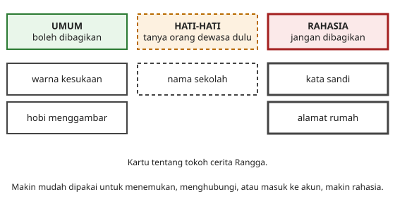

**Ingat dulu:** Tanpa melihat catatan, tulis satu hal yang boleh dibagikan dan satu hal yang tidak.

**Contoh:** Kartu tentang tokoh cerita Rangga.

`[Gambar: tiga kolom. Kolom umum berisi warna kesukaan dan hobi menggambar. Kolom hati-hati berisi nama sekolah. Kolom rahasia berisi kata sandi dan alamat rumah.]`

UMUM: boleh dibagikan. HATI-HATI: tanya orang dewasa dulu. RAHASIA: jangan dibagikan.

**Bandingkan:** A: hobi menggambar Rangga. B: alamat rumah Rangga.

Dari kartu mana orang asing bisa menemukan Rangga? ______

Apa yang sama? Apa yang beda? ______

**Coba:** Tulis U (umum), H (hati-hati), atau R (rahasia).

| Kartu Rangga | U, H, atau R |
| --- | --- |
| warna kesukaan | U |
| sekolah Rangga | ______ |
| nomor telepon | ______ |

Sekarang sendiri: tulis satu alasan mengapa kartu "rumah sedang kosong" itu R. Mulai dengan "karena orang asing bisa ...".

______

Lingkari informasi RAHASIA: kata sandi, hewan kesukaan, alamat rumah, makanan kesukaan.

Jangan tulis informasi pribadimu di lembar ini.

**Ceritakan** ke temanmu: mengapa informasi tertentu perlu dilindungi?

**Catatan cetak (untuk guru, tidak dicetak):** satu lembar per murid, kertas A4. Lembar tidak memuat kolom nama, kelompok, tanggal, atau nilai; penandaan kertas diurus guru di sekolah.
