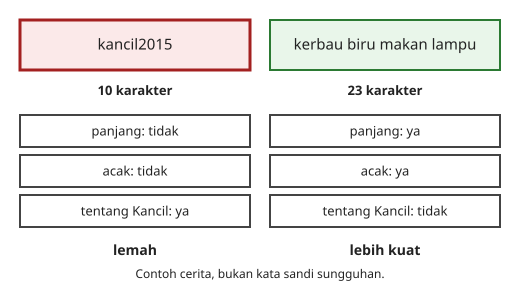

**Ingat dulu:** Tanpa melihat catatan, tulis tiga informasi yang tidak boleh dibagikan kepada orang asing.

**Contoh:** Kancil dan lemari harta. Ini cerita; jangan tulis kata sandimu.

`[Gambar: dua kartu. Kartu kiri kancil2015 dengan sepuluh karakter, tentang Kancil, ditandai lemah. Kartu kanan kerbau biru makan lampu dengan dua puluh tiga karakter, acak, ditandai lebih kuat.]`

Empat aturan: panjang, acak, bukan tentang dirimu, rahasia.

**Bandingkan:** A: kancil2015. B: kerbau biru makan lampu.

| | A | B |
| --- | --- | --- |
| Panjang? | tidak | |
| Acak? | | |
| Tentang Kancil? | | |

Apa yang sama? Apa yang beda? ______

**Coba:** Kartu "kancil suka mentimun".

Panjang: ya. Acak: ______. Tentang Kancil: ______.

Aturan yang dilanggar: ______

Sekarang sendiri: beri ya atau tidak untuk panjang, acak, dan bukan tentang dirimu.

| Kartu cerita | Panjang | Acak | Bukan tentang dirimu |
| --- | --- | --- | --- |
| 123456 | | | |
| kopi hijau lari malam | | | |

Kartu yang lebih kuat: ______

**Ceritakan** ke temanmu: mengapa kata sandi dirahasiakan?

**Catatan cetak (untuk guru, tidak dicetak):** satu lembar per murid, kertas A4. Lembar tidak memuat kolom nama, kelompok, tanggal, atau nilai; penandaan kertas diurus guru di sekolah.
