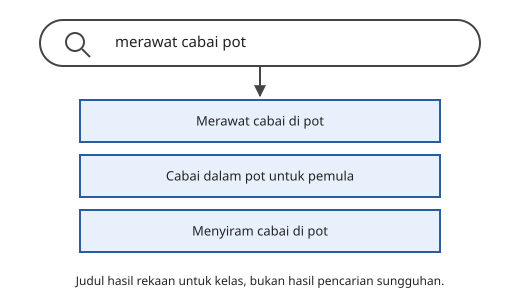

**Ingat dulu:** Tanpa melihat catatan, tulis dua ciri kata sandi yang kuat.

**Contoh:** "Bagaimana cara merawat tanaman cabai di pot?"

`[Gambar: kotak pencarian berisi merawat cabai pot. Di bawahnya tiga kartu judul rekaan: Merawat cabai di pot, Cabai dalam pot untuk pemula, Menyiram cabai di pot.]`

Kata kunci: bagian paling penting dari pertanyaan.

**Bandingkan:** A: cabai. B: merawat cabai pot.

| | A | B |
| --- | --- | --- |
| Berapa kata? | 1 | |
| Terlalu luas atau khusus? | | |

Apa yang sama? Apa yang beda? ______

**Coba:** "Bagaimana membuat kincir angin dari kertas?" Lingkari tiga bagian penting.

bagaimana  membuat  kincir angin  dari  kertas

Sekarang sendiri: tulis kata kunci untuk "Berapa lama kucing tidur dalam sehari?"

______

Buat satu pertanyaan tentang hewan atau hobi. Jangan tulis hal tentang dirimu.

______

**Ceritakan** ke temanmu: bagaimana memilih kata kunci?

**Catatan cetak (untuk guru, tidak dicetak):** satu lembar per murid, kertas A4. Lembar tidak memuat kolom nama, kelompok, tanggal, atau nilai; penandaan kertas diurus guru di sekolah.
