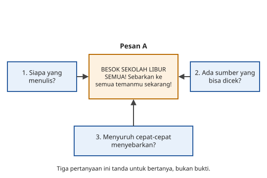

**Ingat dulu:** Tanpa melihat catatan, tulis kata kunci untuk "Bagaimana cara merawat tanaman cabai di pot?"

**Contoh:** Pesan A: "BESOK SEKOLAH LIBUR SEMUA! Sebarkan ke semua temanmu sekarang!"

`[Gambar: kartu pesan di tengah dengan tiga kotak pertanyaan di sekelilingnya. Satu: siapa yang menulis? Dua: ada sumber yang bisa dicek? Tiga: menyuruh cepat-cepat menyebarkan?]`

Tiga pertanyaan ini tanda untuk bertanya, bukan bukti.

**Bandingkan:** A: pesan libur. B: pengumuman piket di papan, ditulis wali kelas.

| | A | B |
| --- | --- | --- |
| Penulis jelas? | tidak | |
| Ada sumber yang bisa dicek? | tidak | |
| Menyuruh menyebarkan? | ya | |

Apa yang sama? Apa yang beda? ______

**Coba:** Pesan C: "Menangkan hadiah! Kirim nomor telepon orang tuamu sekarang!"

Penulis jelas? ______ Menyuruh cepat-cepat? ______ Minta informasi pribadi? ______

Putusan (lingkari): bisa dipercaya sementara / perlu dicek

Sekarang sendiri: Pesan E: "Makan jeruk malam hari membuat rambutmu jadi biru besok pagi."

Putusan (lingkari): bisa dipercaya sementara / perlu dicek

Alasanku: ______

**Ceritakan** ke temanmu: apa tiga pertanyaan cek, dan kepada siapa kamu bertanya bila ragu?

**Catatan cetak (untuk guru, tidak dicetak):** satu lembar per murid, kertas A4. Lembar tidak memuat kolom nama, kelompok, tanggal, atau nilai; penandaan kertas diurus guru di sekolah.
