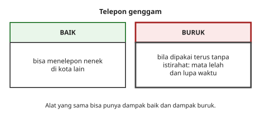

**Ingat dulu:** Tanpa melihat catatan, tulis tiga pertanyaan cek untuk sebuah pesan.

**Contoh:** Telepon genggam.

`[Gambar: tabel dua kolom. Kolom baik berisi bisa menelepon nenek di kota lain. Kolom buruk berisi bila dipakai terus tanpa istirahat, mata lelah dan lupa waktu.]`

Alat yang sama bisa punya dampak baik dan dampak buruk.

**Bandingkan:** Cara A: tablet untuk video belajar sebentar, lalu istirahat. Cara B: menonton tanpa henti sampai lupa makan.

| | Cara A | Cara B |
| --- | --- | --- |
| Alatnya | tablet | |
| Lama memakai | sebentar | |
| Dampaknya | | |

Apa yang sama? Apa yang beda? ______

**Coba:** Pesan keluarga.

| Baik | Buruk |
| --- | --- |
| kabar cepat sampai ke keluarga | ______ |

Sekarang sendiri: pilih mesin pencari, permainan, atau video belajar.

| Pilihanku | Baik | Buruk |
| --- | --- | --- |
| | | |

Satu cara mengurangi dampak buruk: ______

Jangan tulis hal tentang dirimu atau keluargamu.

**Ceritakan** ke temanmu: mengapa satu alat bisa berdampak baik dan buruk?

**Catatan cetak (untuk guru, tidak dicetak):** satu lembar per murid, kertas A4. Lembar tidak memuat kolom nama, kelompok, tanggal, atau nilai; penandaan kertas diurus guru di sekolah.
