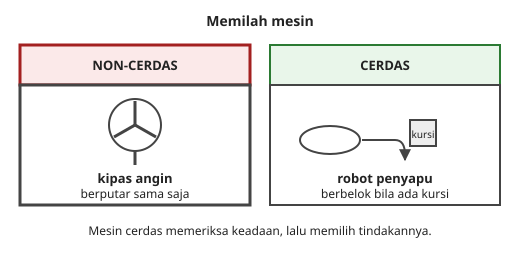

**Ingat dulu:** Tanpa melihat catatan, tulis satu dampak baik dan satu dampak buruk dari satu teknologi digital.

**Contoh:** Kipas angin.

`[Gambar: dua kotak. Kotak non-cerdas berisi kipas angin: berputar sama saja. Kotak cerdas berisi robot penyapu: berbelok bila ada kursi.]`

Mesin cerdas memeriksa keadaan, lalu memilih tindakannya. Mesin non-cerdas mengerjakan satu hal yang tetap.

**Bandingkan:** Kipas angin dan robot penyapu.

| | Kipas angin | Robot penyapu |
| --- | --- | --- |
| Memakai listrik? | ya | |
| Ada kursi di depan | tidak berubah | |

Apa yang sama? Apa yang beda? ______

**Coba:** Tulis C (cerdas) atau N (non-cerdas).

| Kartu | C atau N |
| --- | --- |
| kipas angin | N |
| senter | ______ |
| asisten suara | ______ |

Sekarang sendiri: pemanggang roti ____ robot pemotong rumput ____

Tulis satu ciri mesin cerdas: ______

**Ceritakan** ke temanmu: mengapa kipas angin non-cerdas walau memakai listrik?

**Catatan cetak (untuk guru, tidak dicetak):** satu lembar per murid, kertas A4. Lembar tidak memuat kolom nama, kelompok, tanggal, atau nilai; penandaan kertas diurus guru di sekolah.
