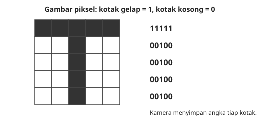

**Ingat dulu:** Tanpa melihat catatan, tulis satu ciri mesin cerdas.

**Contoh:** Gambar piksel huruf T. Kotak gelap = 1. Kotak kosong = 0.

`[Gambar: kisi lima kotak kali lima kotak. Baris pertama gelap semua. Empat baris di bawahnya hanya kotak tengah yang gelap. Di kanan tertulis angka tiap baris: 11111, 00100, 00100, 00100, 00100.]`

Kamera menyimpan angka tiap kotak. Mata dan otak langsung mengartikan.

**Bandingkan:** Huruf T dan huruf I.

| | Huruf T | Huruf I |
| --- | --- | --- |
| Baris 1 | 11111 | 11111 |
| Baris 5 | 00100 | |
| Kotak gelap | 9 | |

Apa yang sama? Apa yang beda? ______

**Coba:** Gelapkan kotak sesuai angka: 00100, 01110, 11111, 00100, 00100.

| | | | | |
| --- | --- | --- | --- | --- |
| | | | | |
| | | | | |
| | | | | |
| | | | | |

Gambar apa ini? ______ Kotak gelap: ____

Sekarang sendiri: 01110, 10001, 10001, 10001, 01110. Huruf apa? ____ Kotak gelap: ____

**Ceritakan** ke temanmu: apa yang sama dan beda antara mata dan kamera?

**Catatan cetak (untuk guru, tidak dicetak):** satu lembar per murid, kertas A4; guru menyediakan kertas kotak tambahan untuk soal sendiri. Lembar tidak memuat kolom nama, kelompok, tanggal, atau nilai; penandaan kertas diurus guru di sekolah.
