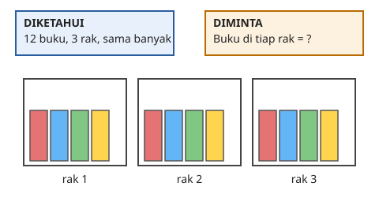

# Pengenalan Berpikir Komputasional

**Ingat dulu:** Tanpa melihat catatan, tulis satu kalimat tentang berpikir komputasional.

**Contoh:** Kancil punya 12 buku dan 3 rak. Buku dibagi sama banyak. Berapa buku di tiap rak?

`[Gambar: tiga rak buku, tiap rak berisi empat buku. Kotak "diketahui" di kiri atas, kotak "diminta" di kanan atas.]`

| Diketahui | Diminta |
| --- | --- |
| 12 buku, 3 rak, sama banyak | buku di tiap rak |

**Bandingkan:** Masalah A adalah masalah Kancil. Masalah B: "Kancil ingin menghias dinding kelas. Berapa lama waktunya?"

| | A | B |
| --- | --- | --- |
| Apa yang diketahui? | | |
| Bisa dijawab? | | |

Apa yang sama? Apa yang beda? Tulis satu kalimat: ______

**Coba:** Kura-kura menanam 15 bibit dalam 3 baris sama banyak.

| Diketahui | Diminta |
| --- | --- |
| 15 bibit, ______ | ______ |

Jawab: ______

Sekarang sendiri: Pak Gagak punya 18 kursi. Ia menata 6 kursi tiap baris. Berapa baris?

| Diketahui | Diminta |
| --- | --- |
| | |

Jawab: ______

**Ceritakan** ke temanmu: bagaimana kamu tahu apa yang diminta?

**Catatan cetak (untuk guru, tidak dicetak):** satu lembar per murid, kertas A4. Lembar tidak memuat kolom nama, kelompok, tanggal, atau nilai; penandaan kertas diurus guru di sekolah.
