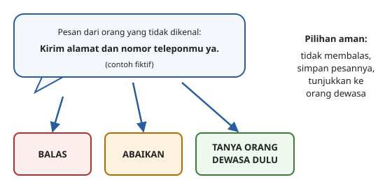

# Interaksi Aman dan Efektif di Beranda Digital

**Ingat dulu:** Tanpa melihat catatan, tulis empat langkah memecahkan masalah.

**Contoh:** Pesan dari orang yang tidak dikenal.

`[Gambar: gelembung pesan "Kirim alamat dan nomor teleponmu ya." dengan tiga panah ke balas, abaikan, dan tanya orang dewasa dulu.]`

Pilihan: tanya orang dewasa dulu. Pesan disimpan, tidak dibalas.

**Bandingkan:**

| | Pesan Bima | Pesan tidak dikenal |
| --- | --- | --- |
| Pengirimnya jelas? | ya | tidak |
| Meminta informasi pribadi? | tidak | ya |
| Sopan? | ya | ______ |

Apa yang sama? Apa yang beda? ______

**Coba:** Pesan: "Kamu payah, jangan ikut kelompok!"

| Langkah | Jawabanmu |
| --- | --- |
| Pahami | ada ejekan |
| Rencanakan | ______ |
| Jalankan | ______ |
| Periksa | ______ |

Sekarang sendiri: tulis pesan sapaan sopan untuk tokoh cerita Rani. Pakai salam, tujuan, dan terima kasih.

______

**Ceritakan** ke temanmu kapan kita perlu bertanya pada orang dewasa.

**Catatan cetak (untuk guru, tidak dicetak):** satu lembar per murid, kertas A4. Lembar tidak memuat kolom nama, kelompok, tanggal, atau nilai; penandaan kertas diurus guru di sekolah.
