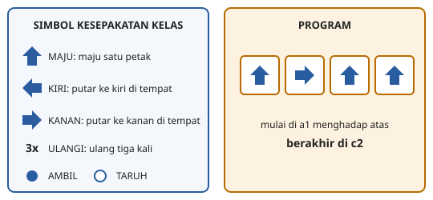

# Penguatan: Instruksi logis dengan simbol

**Ingat dulu:** Tanpa melihat catatan, gambar simbol untuk MAJU dan KANAN.

**Contoh:** Mesin mulai di a1 menghadap atas. Panah atas maju satu petak. Panah kanan memutar ke kanan di tempat.

`[Gambar: daftar simbol (panah atas MAJU, panah kiri KIRI, panah kanan KANAN, 3x ULANGI, titik AMBIL, lingkaran TARUH) dan satu program empat panah: atas, kanan, atas, atas. Berakhir di c2.]`

**Bandingkan:**

| Program | Berakhir di |
| --- | --- |
| P: atas, kanan, atas | b2 |
| Q: kanan, atas, atas | ___ |

Apa yang sama? Apa yang beda? ______

**Coba:** Tujuan b3 dari a1. Atas, atas, ___, atas.

Sekarang sendiri: tujuan d3 dari a1. Tulis programmu dengan simbol dan satu "3x".

______

Uji di kisi. Berakhir di d3? ______

Tantangan: pindahkan tutup botol dari a3 ke c3 dengan titik (AMBIL) dan lingkaran (TARUH).

**Ceritakan** ke temanmu mengapa urutan simbol penting.

**Catatan cetak (untuk guru, tidak dicetak):** satu lembar per murid, kertas A4. Lembar tidak memuat kolom nama, kelompok, tanggal, atau nilai; penandaan kertas diurus guru di sekolah.
