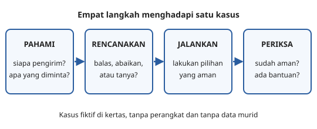

**Ingat dulu:** Tanpa melihat catatan, tulis dua informasi pribadi yang tidak dibagikan.

**Contoh:** Kasus 1. Pesan: "Kamu menang hadiah! Kirim alamat dan nomor teleponmu."

`[Gambar: empat kotak berurutan dengan panah: pahami, rencanakan, jalankan, periksa. Di bawahnya tertulis kasus fiktif di kertas.]`

Pahami: pengirim tidak dikenal. Rencanakan: tanya orang dewasa dulu. Jalankan: tidak membalas. Periksa: tidak ada informasi keluar.

**Bandingkan:** Kasus 1 dan Kasus 2 (situs permainan fiktif meminta nama lengkap dan tanggal lahir).

| | Kasus 1 | Kasus 2 |
| --- | --- | --- |
| Yang meminta | pesan hadiah | situs permainan |
| Informasi yang diminta | alamat, telepon | ______ |

Apa yang sama? Apa yang beda? ______

**Coba:** Kasus 2.

| Langkah | Jawabanmu |
| --- | --- |
| Pahami | situs meminta informasi pribadi |
| Rencanakan | ______ |
| Periksa | ______ |

Sekarang sendiri: Kasus 3. Rani mengejek Dewi di kelompok obrolan kelas fiktif. Apa pilihan Dewi dan bagaimana kita tahu pilihan itu berhasil?

______

**Ceritakan** ke temanmu mengapa pilihan aman bisa berbeda.

**Catatan cetak (untuk guru, tidak dicetak):** satu lembar per murid atau per kelompok, kertas A4. Lembar tidak memuat kolom nama, kelompok, tanggal, atau nilai; penandaan kertas diurus guru di sekolah.
