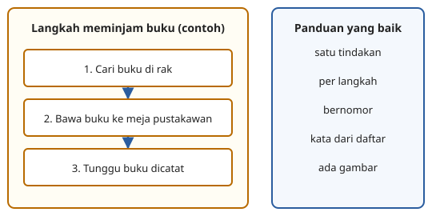

# Proyek mini: panduan "langkah aman memakai internet"

**Ingat dulu:** Tanpa melihat catatan, tulis dua langkah panduan yang boleh bertukar urutan.

**Contoh:** Panduan "Langkah meminjam buku".

`[Gambar: kartu dengan tiga kotak bernomor, cari buku, bawa ke meja pustakawan, tunggu dicatat, dihubungkan panah ke bawah. Di sebelahnya daftar ciri panduan yang baik.]`

**Bandingkan:**

- Panduan A: "Lakukan itu lalu itu, jangan lupa."
- Panduan B: panduan bernomor di atas.

Apa yang sama? Apa yang beda? Mana yang bisa dijalankan murid kelas 3? ______

**Coba:** Panduan untuk kelas 3.

| Nomor | Langkah (satu tindakan) | Gambar |
| --- | --- | --- |
| 1 | Tanya orang dewasa dulu bila ada pesan dari orang asing. | (gambar) |
| 2 | ______ | |
| 3 | ______ | |

Sekarang sendiri: lengkapi lima langkah dan tuliskan satu aturan "jangan bagikan". Tukar dengan kelompok lain, lalu perbaiki langkah yang membingungkan.

______

**Ceritakan** ke temanmu satu langkah yang paling penting.

**Catatan cetak (untuk guru, tidak dicetak):** satu lembar per murid atau per kelompok, kertas A4. Lembar tidak memuat kolom nama, kelompok, tanggal, atau nilai; penandaan kertas diurus guru di sekolah.
