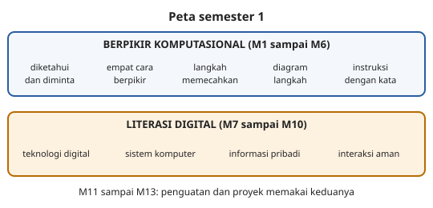

**Ingat dulu:** Tanpa melihat catatan, tulis satu hal dari tiap kelompok: berpikir komputasional dan literasi digital.

**Contoh:** Latihan bentuk soal dengan jawaban lengkap: memilah hewan.

`[Gambar: dua baris. Baris pertama berpikir komputasional, minggu satu sampai enam. Baris kedua literasi digital, minggu tujuh sampai sepuluh.]`

Soal: kucing, ikan, burung. Mana yang bisa terbang? Jawaban: burung, karena punya sayap.

**Bandingkan:**

- Jawaban A: "burung."
- Jawaban B: "burung, karena punya sayap."

Apa yang sama? Apa yang beda? Mana yang memuat alasan? ______

**Coba:** Soal: kartu A, B, C. Pilih yang bukan informasi pribadi: A nomor telepon, B warna kesukaan, C alamat rumah. Jawaban: ______, karena ______.

Sekarang sendiri: tulis satu masalah sehari-hari. Pisahkan apa yang diketahui dan apa yang diminta.

| Diketahui | Diminta |
| --- | --- |
| | |

**Refleksi:** Tulis satu hal yang paling berguna dan satu hal yang mau dipelajari lagi.

______

**Ceritakan** ke temanmu satu hal yang kamu pelajari semester ini.

**Catatan cetak (untuk guru, tidak dicetak):** satu lembar per murid, kertas A4. Lembar ini latihan bentuk soal, bukan kuis sumatif; guru menyusun kuis sendiri. Lembar tidak memuat kolom nama, kelompok, tanggal, atau nilai; penandaan kertas diurus guru di sekolah.
