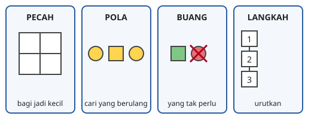

**Ingat dulu:** Tanpa melihat catatan, tulis dua hal yang kamu tuliskan sebelum memecahkan masalah.

**Contoh:** Membuat kalender kelas.

`[Gambar: empat kartu berjajar bertuliskan pecah, pola, buang, langkah, dengan gambar kecil di tiap kartu.]`

| Kartu | Isi |
| --- | --- |
| Pecah | kotak tanggal, nama hari, tanggal, hiasan |
| Pola | tanggal naik satu; tujuh kotak ganti baris |
| Buang | warna hiasan |
| Langkah | kotak, hari, tanggal, hiasan |

**Bandingkan:** Masalah B: menyiapkan rak buku kelas. Kartu mana yang dipakai?

| Kartu | Kalender | Rak buku |
| --- | --- | --- |
| Pecah | ya | |
| Pola | ya | |
| Buang | ya | |
| Langkah | ya | |

Apa yang sama? Apa yang beda? ______

**Coba:** Menyiapkan pojok baca.

| Kartu | Isi |
| --- | --- |
| Pecah | pilih tempat, bawa buku, tata, beri tanda |
| Pola | ______ |
| Buang | ______ |
| Langkah | ______ |

Sekarang sendiri: menghias papan pengumuman.

| Kartu | Isi |
| --- | --- |
| Pecah | |
| Pola | |
| Buang | |
| Langkah | |

**Ceritakan** ke temanmu satu kartu dan alasanmu.

**Catatan cetak (untuk guru, tidak dicetak):** satu lembar per murid, kertas A4. Lembar tidak memuat kolom nama, kelompok, tanggal, atau nilai; penandaan kertas diurus guru di sekolah.
