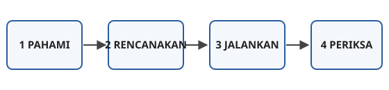

# Pemecahan Masalah dalam Kehidupan Sehari-hari

**Ingat dulu:** Tanpa melihat catatan, tulis empat cara berpikir dari minggu lalu.

**Contoh:** Dua regu, dua tugas, dua hari. Tiap regu mengerjakan tiap tugas sekali.

`[Gambar: empat kotak berpanah: pahami, rencanakan, jalankan, periksa.]`

| Hari | Merah | Biru |
| --- | --- | --- |
| 1 | menyapu | menghapus papan |
| 2 | menghapus papan | menyapu |

**Bandingkan:** Jadwal A: Merah menyapu hari 1 dan 2. Jadwal B: tabel di atas. Apa yang sama? Apa yang beda? ______

**Coba:** Tiga regu dan tiga tugas (1 siram, 2 rapikan buku, 3 buang sampah).

| Hari | Merah | Biru | Hijau |
| --- | --- | --- | --- |
| 1 | 1 | 2 | 3 |
| 2 | 2 | ___ | ___ |
| 3 | ___ | ___ | ___ |

Sekarang sendiri: empat regu (Merah, Biru, Hijau, Kuning) dan empat tugas (1 sapu, 2 hapus, 3 sepatu, 4 siram), empat hari.

| Hari | Merah | Biru | Hijau | Kuning |
| --- | --- | --- | --- | --- |
| 1 | 1 | 2 | 3 | 4 |
| 2 | | | | |
| 3 | | | | |
| 4 | | | | |

**Ceritakan** ke temanmu langkah yang paling membantu.

**Catatan cetak (untuk guru, tidak dicetak):** satu lembar per murid, kertas A4. Lembar tidak memuat kolom nama, kelompok, tanggal, atau nilai; penandaan kertas diurus guru di sekolah.
