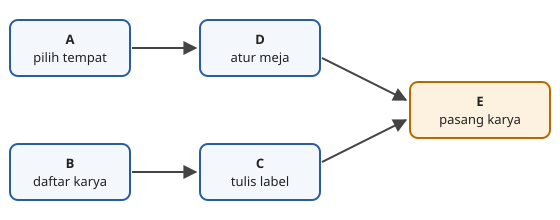

**Ingat dulu:** Tanpa melihat catatan, tulis empat langkah memecahkan masalah.

**Contoh:** Menyiapkan pameran. A pilih tempat. B daftar karya. C tulis label (setelah B). D atur meja (setelah A). E pasang karya (setelah C dan D).

`[Gambar: lima kotak A sampai E. Panah dari A ke D, dari B ke C, dari C dan D ke E.]`

**Bandingkan:**

| Urutan | Hasil |
| --- | --- |
| A B C D E | berhasil |
| B C A D E | berhasil |
| A C B D E | gagal |

Apa yang sama? Apa yang beda? Mengapa yang ketiga gagal? ______

**Coba:** Membuat poster. P pilih judul. Q gambar sketsa (setelah P). R siapkan kertas besar. S tulis di kertas (setelah Q dan R). T tempel (setelah S).

Gambar panah: P ke ___ ; Q ke ___ ; R ke ___ ; S ke ___ .

Sekarang sendiri: tulis satu urutan sah: ___ ___ ___ ___ ___

Tulis urutan sah lain: ___ ___ ___ ___ ___

**Ceritakan** ke temanmu langkah mana yang harus menunggu.

**Catatan cetak (untuk guru, tidak dicetak):** satu lembar per murid, kertas A4. Lembar tidak memuat kolom nama, kelompok, tanggal, atau nilai; penandaan kertas diurus guru di sekolah.
