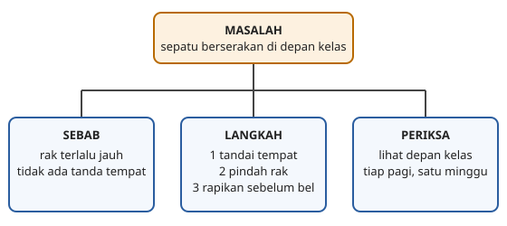

**Ingat dulu:** Tanpa melihat catatan, tulis satu langkah yang boleh bertukar tempat dan satu langkah yang harus menunggu.

**Contoh:** Masalah sepatu berserakan di depan kelas.

`[Gambar: satu kotak masalah di atas, tiga kotak di bawahnya bertuliskan sebab, langkah, dan periksa.]`

**Bandingkan:** Penyajian A: "Murid tidak boleh berantakan." Penyajian B: bagan di atas. Apa yang sama? Apa yang beda? Mana yang memberi tahu apa yang dikerjakan? ______

**Coba:** Pilih satu masalah dari daftar guru, lalu lengkapi.

| Bagian | Isi |
| --- | --- |
| Masalah | |
| Sebab | |
| Langkah 1 | |
| Langkah 2 | |
| Langkah 3 | |
| Cara memeriksa | |

Sekarang gambar bagan kelompokmu di poster dan siapkan penyajian satu menit.

**Ceritakan** ke temanmu bagaimana kita tahu solusinya berhasil.

**Catatan cetak (untuk guru, tidak dicetak):** satu lembar per kelompok atau per murid, kertas A4. Lembar tidak memuat kolom nama, kelompok, tanggal, atau nilai; penandaan kertas diurus guru di sekolah.
