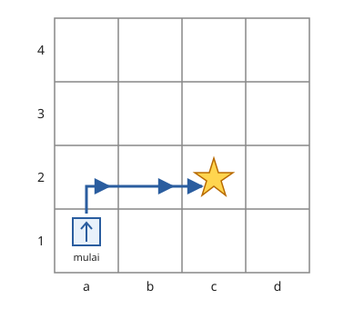

**Ingat dulu:** Tanpa melihat catatan, tulis satu langkah yang harus menunggu pada diagram.

**Contoh:** Mesin mulai di a1 menghadap atas. MAJU maju satu petak. KANAN memutar ke kanan di tempat.

`[Gambar: kisi 4x4, kolom a sampai d, baris 1 sampai 4. Panah dari a1 naik ke a2, belok kanan ke b2 dan c2, tempat bintang.]`

Program: MAJU, KANAN, MAJU, MAJU. Berakhir di c2.

**Bandingkan:**

| Program | Berakhir di |
| --- | --- |
| A: MAJU, MAJU, KANAN, MAJU, MAJU | c3 |
| B: MAJU, KANAN, MAJU, MAJU, MAJU | ___ |

Apa yang sama? Apa yang beda? ______

**Coba:** Tujuan c2 dari a1. MAJU, ___, MAJU, ___

Sekarang sendiri: tujuan d3 dari a1. Tulis programmu dengan kata MAJU, KIRI, KANAN, ULANGI.

Uji di kisi. Berakhir di d3? ______

**Ceritakan** ke temanmu mengapa urutan penting.

**Catatan cetak (untuk guru, tidak dicetak):** satu lembar per murid, kertas A4. Lembar tidak memuat kolom nama, kelompok, tanggal, atau nilai; penandaan kertas diurus guru di sekolah.
