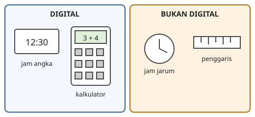

# Konsep Dasar Teknologi Digital

**Ingat dulu:** Tanpa melihat catatan, tulis satu akibat baik dan satu akibat buruk teknologi.

**Contoh:** Jam angka dan jam jarum.

`[Gambar: dua kolom, digital dan bukan digital. Digital berisi jam angka dan kalkulator; bukan digital berisi jam jarum dan penggaris.]`

**Bandingkan:**

| | Jam angka | Jam jarum |
| --- | --- | --- |
| Menunjukkan waktu | ya | ya |
| Mengolah data | ya | tidak |
| Digital? | ya | tidak |

Apa yang sama? Apa yang beda? ______

**Coba:** Telepon genggam.

| Teknologi | Manfaat | Yang perlu diwaspadai |
| --- | --- | --- |
| telepon genggam | berkomunikasi | ______ |

Sekarang sendiri: tulis dua teknologi digital yang kamu kenal.

| Teknologi | Manfaat | Yang perlu diwaspadai |
| --- | --- | --- |
| | | |
| | | |

Lingkari yang digital: kalkulator, penggaris, jam jarum, jam angka.

**Ceritakan** ke temanmu mengapa jam angka digital.

**Catatan cetak (untuk guru, tidak dicetak):** satu lembar per murid, kertas A4. Lembar tidak memuat kolom nama, kelompok, tanggal, atau nilai; penandaan kertas diurus guru di sekolah.
