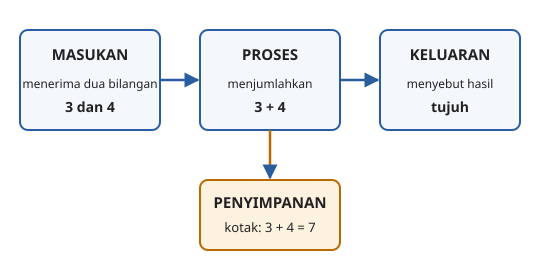

**Ingat dulu:** Tanpa melihat catatan, tulis satu contoh masukan, proses, dan keluaran pada sebuah alat.

**Contoh:** Komputer manusia menghitung 3 + 4.

`[Gambar: tiga kotak berurutan, masukan, proses, keluaran, dihubungkan panah. Dari proses, panah turun ke kotak penyimpanan yang berisi 3 + 4 = 7.]`

**Bandingkan:** Listrik padam.

| | Putaran A | Putaran B |
| --- | --- | --- |
| Ada penyimpanan? | ya | tidak |
| Hasil setelah listrik padam | ada di kotak | ______ |

Apa yang sama? Apa yang beda? ______

**Coba:** Hitung 9 - 4.

| Peran | Tugas |
| --- | --- |
| Masukan | menerima 9 dan 4 |
| Proses | ______ |
| Keluaran | ______ |
| Penyimpanan | ______ |

Sekarang sendiri: hitung 6 + 5 dan isi empat peran di buku tulismu.

Mengapa penyimpanan diperlukan? ______

**Ceritakan** ke temanmu apa tugas tiap peran.

**Catatan cetak (untuk guru, tidak dicetak):** satu lembar per murid, kertas A4. Lembar tidak memuat kolom nama, kelompok, tanggal, atau nilai; penandaan kertas diurus guru di sekolah.
