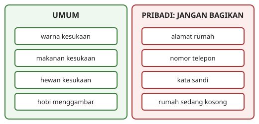

# Keamanan Informasi Pribadi

**Ingat dulu:** Tanpa melihat catatan, tulis satu hal yang perlu diwaspadai dari teknologi digital.

**Contoh:** Kartu tentang tokoh cerita Dina.

`[Gambar: dua kolom. Kolom umum berisi warna kesukaan, makanan kesukaan, hewan kesukaan, hobi menggambar. Kolom pribadi berisi alamat rumah, nomor telepon, kata sandi, rumah sedang kosong.]`

**Bandingkan:**

- Pesan A: "Aku suka bakso. Ada yang suka juga?"
- Pesan B: "Aku Dina Contoh, kelas 5, Jalan Contoh nomor 12. Minggu ini rumahku kosong."

Apa yang sama? Apa yang beda? Dari pesan mana orang asing bisa menemukan Dina? ______

**Coba:** Tulis U (umum) atau P (pribadi).

| Kartu Dina | U atau P |
| --- | --- |
| nomor telepon | P |
| hewan kesukaan | ______ |
| alamat rumah Dina | ______ |

Sekarang sendiri: tulis satu aturan "jangan bagikan" dengan katamu.

______

Lingkari informasi pribadi: kata sandi, hobi menggambar, tanggal lahir lengkap, makanan kesukaan.

Jangan tulis informasi pribadimu di lembar ini.

**Ceritakan** ke temanmu mengapa dua informasi biasa bisa berbahaya bila digabung.

**Catatan cetak (untuk guru, tidak dicetak):** satu lembar per murid, kertas A4. Lembar tidak memuat kolom nama, kelompok, tanggal, atau nilai; penandaan kertas diurus guru di sekolah.
