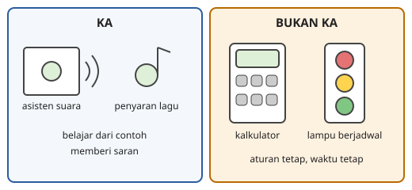

# Pengenalan KA

**Ingat dulu:** Tanpa melihat catatan, tulis satu contoh masukan, proses, dan keluaran pada sebuah alat di rumah.

**Contoh:** Penyaran lagu adalah KA. Kalkulator bukan KA.

`[Gambar: dua kolom, KA dan bukan KA. KA berisi asisten suara dan penyaran lagu; bukan KA berisi kalkulator dan lampu lalu lintas berjadwal.]`

**Bandingkan:**

| | Penyaran lagu | Kalkulator |
| --- | --- | --- |
| Memberi hasil | ya | ya |
| Memakai contoh data | ya | tidak |
| Aturannya selalu tetap | tidak | ya |
| KA? | ya | tidak |

Apa yang sama? Apa yang beda? ______

**Coba:** Asisten suara. KA atau bukan? Alasannya: ______

Sekarang sendiri: pilah kartu robot penyapu, jam alarm, senter, dan penerjemah teks. Tulis KA atau BUKAN KA.

| Kartu | KA atau bukan | Alasan |
| --- | --- | --- |
| robot penyapu | | |
| jam alarm | | |
| senter | | |
| penerjemah teks | | |

Tulis satu contoh KA yang mungkin ada di rumah: ______

**Ceritakan** ke temanmu mengapa kalkulator bukan KA.

**Catatan cetak (untuk guru, tidak dicetak):** satu lembar per murid, kertas A4. Lembar tidak memuat kolom nama, kelompok, tanggal, atau nilai; penandaan kertas diurus guru di sekolah.
