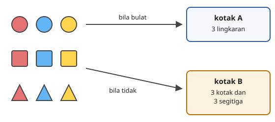

**Ingat dulu:** Tanpa melihat catatan, tulis satu aturan yang memisahkan kartu bulat dari kartu yang tidak bulat.

**Contoh:** Tujuan: semua kartu bulat masuk kotak A. Aturan: AMBIL satu kartu. Bila bulat, TARUH di kotak A. Bila tidak, TARUH di kotak B.

`[Gambar: sembilan kartu. Tiga lingkaran masuk kotak A. Enam kartu lain masuk kotak B.]`

**Bandingkan:** Tujuan: semua kartu merah masuk kotak A.

| Kartu merah | Aturan 1: bila merah | Aturan 2: bila bulat dan merah |
| --- | --- | --- |
| lingkaran | A | A |
| kotak | A | B |
| segitiga | ______ | ______ |

Apa yang sama? Apa yang beda? Aturan mana yang cocok dengan tujuan? ______

**Coba:** Tujuan: semua kotak masuk kotak A. Lengkapi aturannya.

AMBIL satu kartu. Bila ______, TARUH di kotak A. Bila tidak, TARUH di kotak B.

Sekarang sendiri: tulis tujuanmu dan aturanmu.

| Tujuanku | Aturanku | Kartu yang salah tempat |
| --- | --- | --- |
| | | |

Tukar aturanmu dengan kelompok lain. Perbaiki bila ada kartu yang salah tempat: ______

**Ceritakan** ke temanmu bagaimana kamu tahu aturanmu sudah cocok dengan tujuan.

**Catatan cetak (untuk guru, tidak dicetak):** satu lembar per murid, kertas A4. Lembar tidak memuat kolom nama, kelompok, tanggal, atau nilai; penandaan kertas diurus guru di sekolah.
