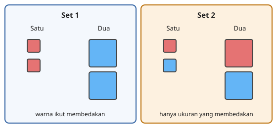

# Penguatan: Instruksi untuk mesin yang belajar

**Ingat dulu:** Tanpa melihat catatan, tulis contoh kartu seperti apa yang membantu mesin menebak dengan baik.

**Contoh:** Instruksi pelatihan: ULANGI 4 kali: AMBIL satu kartu contoh. TARUH di tumpukan sesuai labelnya.

`[Gambar: dua set kartu contoh. Set 1: kartu Satu semuanya kecil merah, kartu Dua semuanya besar biru. Set 2: kartu Satu kecil merah dan kecil biru, kartu Dua besar merah dan besar biru.]`

**Bandingkan:** kartu baru kecil biru.

| | Set 1 | Set 2 |
| --- | --- | --- |
| Kartu Satu | kecil merah, kecil merah | kecil merah, kecil biru |
| Kartu Dua | besar biru, besar biru | besar merah, besar biru |
| Tebakan untuk kecil biru | ragu | Satu |

Apa yang sama? Apa yang beda? ______

**Coba:** Set 2 dan kartu baru besar kuning. Tebakan: ______, karena ______.

Sekarang sendiri: tulis instruksi pelatihan memakai AMBIL, TARUH, dan ULANGI.

| Instruksi pelatihanku |
| --- |
| |
| |

Pilih enam kartu contoh. Apakah warnanya beragam? ______

Tukar instruksimu dengan kelompok lain. Tebakan mana yang keliru? ______

**Ceritakan** ke temanmu dua hal yang kamu periksa pada kartu contoh sebelum melatih mesin.

**Catatan cetak (untuk guru, tidak dicetak):** satu lembar per murid, kertas A4. Lembar tidak memuat kolom nama, kelompok, tanggal, atau nilai; penandaan kertas diurus guru di sekolah.
