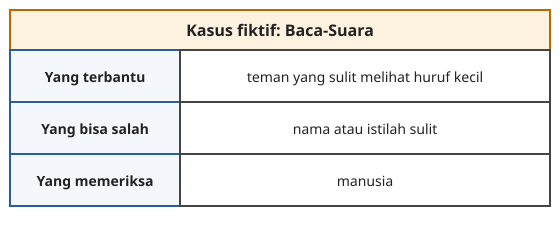

# Penguatan: KA untuk kesejahteraan

**Ingat dulu:** Tanpa melihat catatan, tulis satu manfaat KA dan satu batas yang perlu dijaga supaya KA tidak merugikan manusia.

**Contoh:** Kasus Baca-Suara membacakan teks bagi teman yang sulit melihat huruf kecil.

`[Gambar: tabel kasus Baca-Suara dengan tiga baris. Yang terbantu: teman yang sulit melihat huruf kecil. Yang bisa salah: nama atau istilah sulit. Yang memeriksa: manusia.]`

**Bandingkan:** dua kasus yang dibacakan guru.

| | Baca-Suara | Tebak-Nilai |
| --- | --- | --- |
| Yang terbantu | teman yang sulit melihat huruf kecil | ______ |
| Yang bisa dirugikan | tidak ada bila diperiksa | murid yang salah ditebak |

Apa yang sama? Apa yang beda? ______

**Coba:** Kasus Pantau-Wajah merekam wajah murid. Siapa yang bisa dirugikan? ______ Aturan apa yang menjaga murid? ______

Sekarang sendiri: tulis satu KA yang membantu dan satu KA yang berisiko. Boleh karangan.

| | KA yang membantu | KA yang berisiko |
| --- | --- | --- |
| Siapa yang terbantu atau bisa dirugikan | | |
| Siapa yang memeriksa | | |

Aturanku agar KA tidak merugikan manusia: ______

**Ceritakan** ke temanmu mengapa manusia tetap memeriksa tebakan KA.

**Catatan cetak (untuk guru, tidak dicetak):** satu lembar per murid, kertas A4. Lembar tidak memuat kolom nama, kelompok, tanggal, atau nilai; penandaan kertas diurus guru di sekolah.
