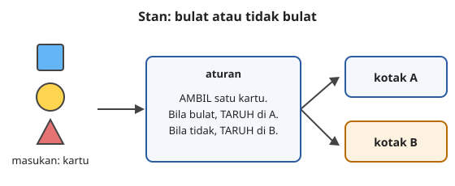

**Ingat dulu:** Tanpa melihat catatan, tulis tiga bagian mesin kotak: masukan, aturan, dan keluaran.

**Contoh:** Rencana stan yang sudah terisi: mesin kotak yang memisahkan kartu bulat dari yang tidak bulat.

`[Gambar: tiga kotak dari kiri ke kanan. Masukan: kartu. Aturan: bila bulat, TARUH di kotak A, bila tidak, TARUH di kotak B. Keluaran: kotak A dan kotak B.]`

**Bandingkan:** dua stan.

| | Stan A | Stan B |
| --- | --- | --- |
| Aturan tertulis | ya | tidak |
| Menjelaskan masukan, aturan, keluaran | ya | tidak |

Apa yang sama? Apa yang beda? Stan mana yang membuat pengunjung paham? ______

**Coba:** Lengkapi rencana stanmu.

| Bagian | Isi |
| --- | --- |
| Judul stan | |
| Aturan (AMBIL, TARUH) | |
| Kartu masukan yang akan kuubah | |
| Akibatnya pada hasil | |
| Peran yang kupegang | |

Setelah pameran, tulis satu hal yang sudah baik dan satu saran dari pengunjung: ______

**Ceritakan** ke temanmu bagaimana mengubah kartu masukan mengubah hasil mesin.

**Catatan cetak (untuk guru, tidak dicetak):** satu lembar per murid, kertas A4. Lembar tidak memuat kolom nama, kelompok, tanggal, atau nilai; penandaan kertas diurus guru di sekolah.
