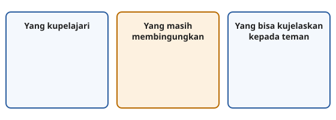

**Ingat dulu:** Tanpa melihat catatan, tulis satu contoh KA dan satu benda yang bukan KA.

**Contoh:** Soal latihan: kipas termasuk cerdas atau non-cerdas? Jawaban: non-cerdas, karena mengerjakan satu hal yang tetap.

`[Gambar: tiga kotak berjajar bertuliskan yang kupelajari, yang masih membingungkan, dan yang bisa kujelaskan kepada teman.]`

**Bandingkan:** dua jawaban atas soal yang sama.

| Jawaban A | Jawaban B |
| --- | --- |
| cerdas | cerdas, karena menyesuaikan dengan keadaan |

Apa yang sama? Apa yang beda? Jawaban mana yang bisa kita periksa? ______

**Coba:** Tulis aturan yang memisahkan kartu bulat dari kartu yang tidak bulat: ______

Sekarang sendiri: kuis dari gurumu dikerjakan di kertas lain. Di sini, isi refleksimu.

| Yang kupelajari | Yang masih membingungkan | Yang bisa kujelaskan kepada teman |
| --- | --- | --- |
| | | |

**Ceritakan** ke temanmu satu hal yang sekarang bisa kamu jelaskan tentang KA.

**Catatan cetak (untuk guru, tidak dicetak):** satu lembar per murid, kertas A4. Kuis sumatif disusun dan dicetak guru terpisah; lembar ini untuk latihan dan refleksi. Lembar tidak memuat kolom nama, kelompok, tanggal, atau nilai; penandaan kertas diurus guru di sekolah.
