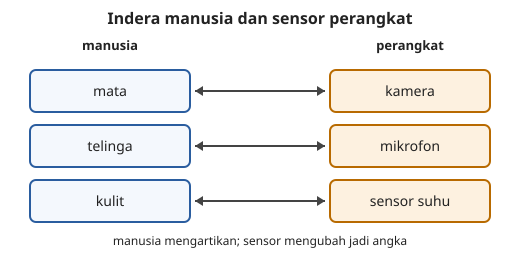

**Ingat dulu:** Tanpa melihat catatan, tulis siapa yang jadi masukan dan siapa yang jadi keluaran dalam komputer manusia.

**Contoh:** Mata dan kamera sama-sama menangkap cahaya.

`[Gambar: tiga baris berpasangan dengan panah dua arah. Mata dengan kamera, telinga dengan mikrofon, kulit dengan sensor suhu.]`

**Bandingkan:**

| | Telinga manusia | Mikrofon kertas |
| --- | --- | --- |
| Menerima bunyi | ya | ya |
| Mengatakan "tepukan keras" | ya | tidak |
| Mengatakan angka kerasnya | bisa | ya |

Apa yang sama? Apa yang beda? ______

**Coba:** Kulit dan sensor suhu.

| Manusia | Sensor |
| --- | --- |
| kulit merasa hangat | sensor suhu menyebut ______ |

Sekarang sendiri: lengkapi tabel.

| Indera manusia | Sensor perangkat | Yang sama | Yang beda |
| --- | --- | --- | --- |
| mata | kamera | | |
| telinga | mikrofon | | |

Siapa yang mengartikan hasil penginderaan: manusia atau sensor? ______

**Ceritakan** ke temanmu mengapa sensor menyebut angka, bukan arti.

**Catatan cetak (untuk guru, tidak dicetak):** satu lembar per murid, kertas A4. Lembar tidak memuat kolom nama, kelompok, tanggal, atau nilai; penandaan kertas diurus guru di sekolah.
