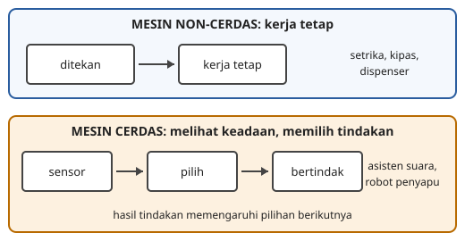

# Mesin Cerdas versus Mesin Non-Cerdas

**Ingat dulu:** Tanpa melihat catatan, tulis satu contoh KA dan satu benda yang bukan KA.

**Contoh:** Kipas: non-cerdas, karena bekerja sama saja.

`[Gambar: dua alur. Non-cerdas: ditekan lalu kerja tetap, contoh setrika, kipas, dispenser. Cerdas: sensor, pilih, bertindak, contoh asisten suara dan robot penyapu.]`

**Bandingkan:**

| | Kipas | Robot penyapu |
| --- | --- | --- |
| Memakai listrik | ya | ya |
| Melihat keadaan sekitar | tidak | ya |
| Menyesuaikan tindakan | tidak | ya |
| Cerdas? | tidak | ya |

Apa yang sama? Apa yang beda? ______

**Coba:** Dispenser dan asisten suara.

| Perangkat | Cerdas atau non-cerdas | Cirinya |
| --- | --- | --- |
| dispenser | non-cerdas | ______ |
| asisten suara | ______ | ______ |

Sekarang sendiri: kartu setrika.

| Perangkat | Cerdas atau non-cerdas | Cirinya |
| --- | --- | --- |
| setrika | | |

Lengkapi: Mesin cerdas ______. Mesin non-cerdas ______.

**Ceritakan** ke temanmu mengapa dispenser non-cerdas walau memakai listrik.

**Catatan cetak (untuk guru, tidak dicetak):** satu lembar per murid, kertas A4. Lembar tidak memuat kolom nama, kelompok, tanggal, atau nilai; penandaan kertas diurus guru di sekolah.
